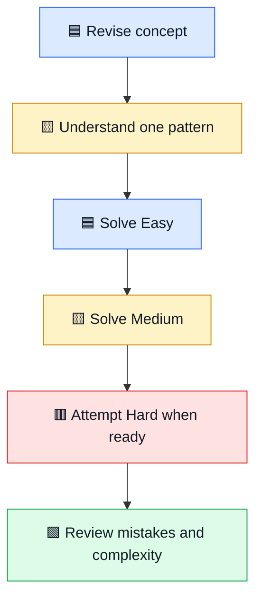
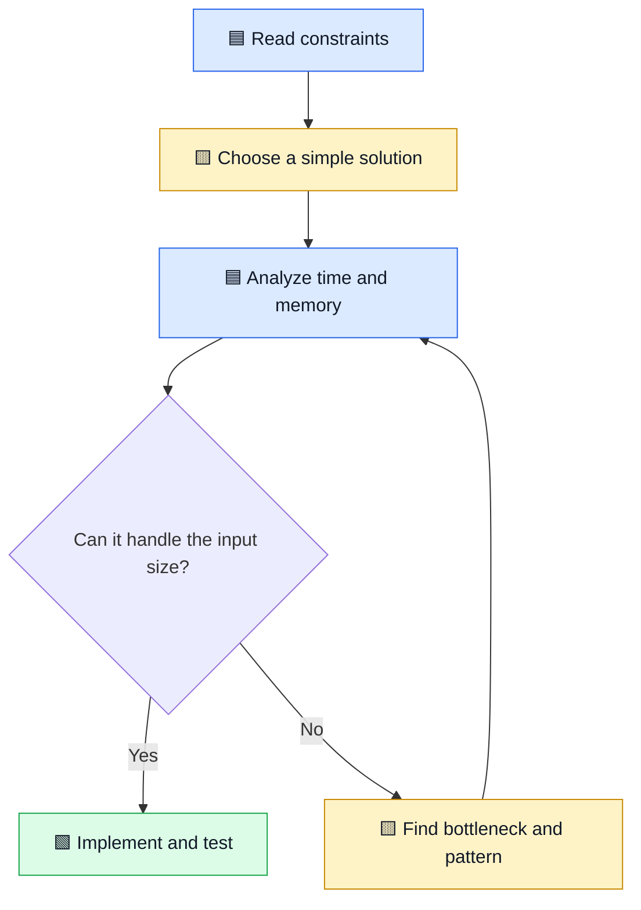

# 🟦 30-Day DSA Roadmap: Aim for 90–100 Problems

DSA means Data Structures and Algorithms. This plan helps you build a practice habit instead of solving random problems without understanding the pattern.

[⬅ Articles index](README.md) · [Main repository](../README.md) · [YouTube channel](https://youtube.com/@mohammad-pse)

## 🧠 Understand the basics

- **Data structure:** how data is organized, such as an array, stack, or tree.
- **Algorithm:** steps used to solve a problem.
- **Time complexity:** how the amount of work grows as input grows.
- **Space complexity:** how memory usage grows as input grows.
- **Pattern:** a reusable technique, such as two pointers or sliding window.

Hinglish: pattern samajhne ka matlab hai pehchanna ki problem ko solve karne ke liye kaunsi known technique useful ho sakti hai.

## 🎯 Daily practice flow

90–100 problems is a stretch target, not a guarantee. If you are new to coding, understanding fewer problems deeply is better than copying many solutions. Attempt hard problems after learning the basics and revisit them later.

## 📅 30-day topic plan

| Day | Topic | Practice focus |
|---:|---|---|
| 1 | Problem solving and Big O | Inputs, constraints, complexity |
| 2 | Arrays basics | Traversal, min/max, prefix sums |
| 3 | Two pointers | Pair sums, sorted arrays |
| 4 | Sliding window | Fixed and variable windows |
| 5 | Hash maps and sets | Frequency counts, duplicates |
| 6 | Sorting and binary search | Search boundaries |
| 7 | Review | Re-solve missed problems |
| 8 | Strings | Frequency, palindrome, parsing |
| 9 | Linked lists | Reverse, middle, cycle |
| 10 | Stack | Valid parentheses, monotonic stack intro |
| 11 | Queue and deque | Queue operations, window problems |
| 12 | Recursion | Base case and recursive step |
| 13 | Backtracking | Subsets, permutations |
| 14 | Review | Mixed easy and medium problems |
| 15 | Trees | Traversal, height, depth |
| 16 | Binary search trees | Search and validation |
| 17 | Heap / priority queue | Top K and smallest/largest |
| 18 | Graphs | Representations, BFS, DFS |
| 19 | Graph patterns | Components and cycles |
| 20 | Topological sort | Dependency ordering |
| 21 | Review | Trees and graphs |
| 22 | Greedy algorithms | Local choices and when they work |
| 23 | Dynamic programming basics | State, transition, base case |
| 24 | 1D dynamic programming | Climbing stairs, house robber |
| 25 | 2D dynamic programming | Grid paths and table states |
| 26 | Intervals | Merge and schedule intervals |
| 27 | Bit manipulation | AND, OR, XOR, shifts |
| 28 | Mixed practice | Identify the pattern first |
| 29 | Mock interview | Timed problem and explanation |
| 30 | Final review | Weak topics and next-month plan |

Some topics, especially graphs and dynamic programming, may need more than one day. Adjust the schedule to your current level.

## 🧩 Easy → Medium → Hard

1. **Easy:** learn the core technique and implement it correctly.
2. **Medium:** combine the technique with constraints or another idea.
3. **Hard:** try deeper variations after you can explain the basics.

Do not force a hard problem while the prerequisite is unclear. Study hints, understand the solution, close it, and implement it again yourself.

## ⏱️ Big O in simple language

| Complexity | Intuition | Example |
|---|---|---|
| O(1) | Work stays roughly constant | Array access by index |
| O(log n) | Problem shrinks by a factor | Binary search |
| O(n) | Work grows with item count | One pass through an array |
| O(n log n) | Common efficient sorting growth | Merge sort |
| O(n²) | Compare many pairs | Nested loop over pairs |

## 📝 Track each problem

Record the topic, pattern, whether you solved it independently, complexity, edge cases, what you learned, and when to revisit it. Review the next day, a few days later, and the following week.

## 🔗 Practice resources

- [LeetCode Top Interview 150](https://leetcode.com/studyplan/top-interview-150/)
- [NeetCode Roadmap](https://neetcode.io/roadmap)
- [Big-O Cheat Sheet](https://www.bigocheatsheet.com/)

## 🎥 Related video

[▶ DSA Interview Template on YouTube Shorts](https://youtube.com/shorts/9IO1mewQah0?si=IYnkDZs2uxsb0x5R)

[⬆ Articles index](README.md)

## 🏷️ Tags

`DSA` `Data-Structures` `Algorithms` `Big-O` `LeetCode` `Coding-Interview` `30-Day-Plan` `Problem-Solving` `Dynamic-Programming` `Hinglish`
