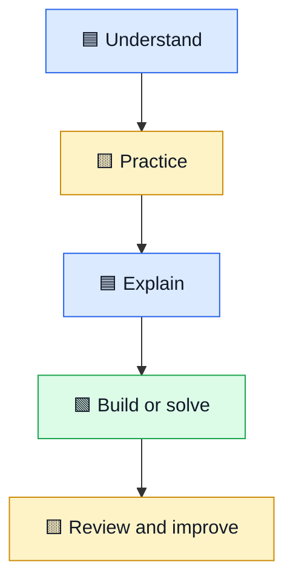

# 🎨 Visual Learning Articles

Simple explanations, colorful diagrams, practical roadmaps, and Hinglish notes for difficult terms.

## 🧭 Choose a guide

| Guide | What you'll learn |
|---|---|
| [🟩 NVIDIA AI & GPU Stack](nvidia-ai-gpu-stack.md) | GPU hardware, CUDA, cuDNN, TensorRT, NCCL, NIM and NeMo |
| [🟨 Data Analyst Roadmap](data-analyst-roadmap.md) | Python, NumPy, pandas, SQL, cleaning, analysis and charts |
| [🟦 30-Day DSA Roadmap](30-day-dsa-roadmap.md) | Data structures, Big O, patterns and a 30-day plan |
| [🟥 DSA Interview Template](dsa-interview-template.md) | A repeatable process for solving coding interview problems |

## 🗺️ Recommended learning flow

## 🎨 Color key

- 🟦 Blue: starting point, input, or core concept.
- 🟨 Yellow: important tip, decision, or reminder.
- 🟩 Green: output, success, or next action.
- 🟥 Red: pitfalls and common mistakes.

## 🎥 Videos and updates

- [Watch the DSA Interview Template Short](https://youtube.com/shorts/9IO1mewQah0?si=IYnkDZs2uxsb0x5R)
- [Visit the YouTube channel](https://youtube.com/@mohammad-pse)
- [Back to the main Engineering Interview Prep repository](../README.md)

Hinglish note: technical terms ko simple language aur examples ke saath explain kiya gaya hai, taaki concept samajh aaye, sirf yaad na karna pade.
