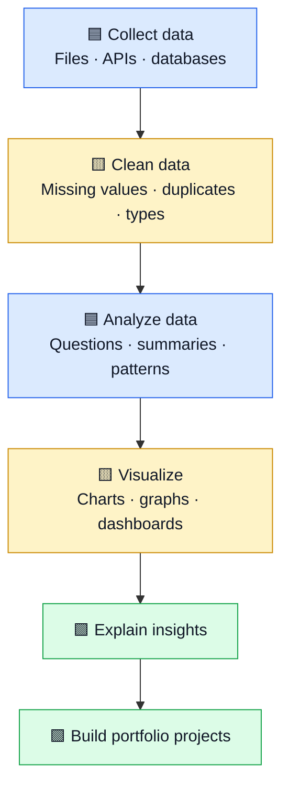

# 🟨 Data Analyst Roadmap for Beginners

Learn to collect, clean, analyze, and visualize data — then explain the findings through projects.

[⬅ Articles index](README.md) · [Main repository](../README.md) · [YouTube channel](https://youtube.com/@mohammad-pse)

## 🗺️ Roadmap at a glance



## 🧰 Core tools

| Tool | What it does | Simple Hinglish |
|---|---|---|
| **Python** | Programming and automation for data work. | Code se data process aur analyze karna. |
| **NumPy** | Numerical arrays and math operations. | Numbers aur arrays par calculations. |
| **pandas** | Filters, cleans, groups, and joins table-shaped data. | Excel jaisi tables ko Python mein handle karna. |
| **Matplotlib** | Creates charts and plots. | Data ko graph mein dikhana. |
| **SQL** | Retrieves and summarizes relational database data. | Database se required data nikalna. |

## 1. Ask a useful question

Examples: Which product sells the most? Which month has the highest revenue? Which region is growing? A good analyst answers a real question, not just creates colorful charts.

## 2. Collect data

Data may come from CSV or Excel files, databases, APIs, or public datasets. Understand the source, permissions, date range, and field meanings before analysis.

## 3. Clean and prepare data

- **Missing values:** fields that are blank or unavailable.
- **Duplicates:** repeated records that may inflate totals.
- **Data types:** dates stored as text or numbers stored as strings.
- **Inconsistent labels:** for example, Hyderabad, hyderabad, and HYD may need a documented mapping.
- **Outliers:** unusual values to investigate, not automatically delete.

## 4. Analyze with pandas

Example column names are illustrative; adjust them to match your dataset.

```python
import pandas as pd

df = pd.read_csv("sales.csv")

print(df.head())
print(df.info())
print(df.isna().sum())

summary = (
    df.groupby("region", dropna=False)["revenue"]
      .sum()
      .sort_values(ascending=False)
)
print(summary)
```

## 5. Visualize the result

| Chart | Best for |
|---|---|
| Bar chart | Comparing categories, such as sales by region |
| Line chart | Trends over time |
| Histogram | Distribution of numeric values |
| Scatter plot | Relationship between two numeric variables |
| Pie chart | A small number of parts of a whole, where comparison is clear |

```python
import matplotlib.pyplot as plt

summary.plot(kind="bar", title="Revenue by Region")
plt.xlabel("Region")
plt.ylabel("Revenue")
plt.tight_layout()
plt.show()
```

Chart tip: choose the chart based on the question. Clear labels and honest scales matter more than decoration.

## 6. Learn SQL

Start with SELECT, WHERE, ORDER BY, GROUP BY, aggregate functions, joins, and subqueries.

```sql
SELECT region, SUM(revenue) AS total_revenue
FROM sales
GROUP BY region
ORDER BY total_revenue DESC;
```

This groups sales by region, totals revenue, and shows the largest totals first.

## 7. Build projects

1. **Sales analysis:** revenue by month, product, and region.
2. **E-commerce:** order trends, basket size, repeat customers.
3. **Customer churn:** explore patterns associated with cancellations.
4. **Public dataset dashboard:** document your question, approach, findings, and limitations.

Publish the question, source, cleaning decisions, analysis, charts, and conclusion. Never upload private or sensitive data.

## 📆 Six-week starter plan

| Week | Focus | Deliverable |
|---|---|---|
| 1 | Python basics and files | Load and inspect a CSV |
| 2 | NumPy and pandas | Clean and summarize data |
| 3 | SQL basics and joins | Answer 10–15 data questions |
| 4 | Matplotlib and chart selection | Create five clear charts |
| 5 | End-to-end analysis | Complete one project |
| 6 | Portfolio and communication | Publish and explain the project |

## 🎤 Interview checklist

- How did you handle missing values?
- When would you use a join versus a group-by?
- Which chart would you use for a time trend?
- What can the median tell you that the mean may hide?
- How would you investigate a surprising result?
- Can you explain a project to a non-technical person?

## 🔗 Further learning

- [Python tutorial](https://docs.python.org/3/tutorial/)
- [NumPy quickstart](https://numpy.org/doc/stable/user/quickstart.html)
- [pandas getting started](https://pandas.pydata.org/docs/getting_started/index.html)
- [Matplotlib tutorials](https://matplotlib.org/stable/tutorials/index.html)
- [SQLBolt interactive lessons](https://sqlbolt.com/)

[⬆ Articles index](README.md)
