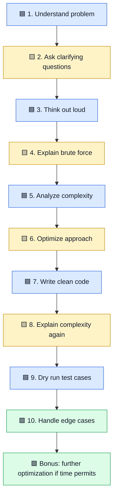

# 🟥 DSA Interview Template: Step-by-Step Framework

<div align="center">

[](#)
[](#)
[](#)
[](https://mermaid.js.org/)

</div>

Use the same clear process for coding interviews: understand the problem, explain your approach, compare solutions, code carefully, and test.

[⬅ Articles index](README.md) · [Main repository](../README.md) · [YouTube channel](https://youtube.com/@mohammad-pse)

## 🧭 The interview flow



## 1. 🟦 Understand the problem statement

Restate the task in your own words. Identify the input, expected output, constraints, input size, and special cases.

Say: “Let me restate the problem to make sure I understand the expected output.”

## 2. 🟨 Ask clarifying questions

Ask questions that can change your solution:
- Can input be empty?
- Can values be negative?
- Are duplicates allowed?
- How large can the input be?
- Is the array sorted?
- What should happen if no answer exists?

## 3. 🟦 Think out loud

Explain the useful reasoning: what you notice, what options you are considering, and why. You do not need to narrate every thought.

Say: “A direct approach is easy to reason about, but may be slow for large input. I'll analyze it first, then look for a faster approach.”

## 4. 🟨 Discuss brute force

Brute force means the most direct solution, often with fewer tricks. Explain the idea, why it works, time and space costs, and what becomes slow as input grows.

Example: to find whether an array contains a pair that adds up to a target, check every pair.

## 5. 🟦 Explain complexity

**Time complexity** estimates how work grows as input grows. **Space complexity** estimates how extra memory grows.

Hinglish: input bada hone par kitna extra kaam aur memory lagegi, complexity uska estimate hai.

For checking every pair, time can be O(n²). If only a few variables are used, extra space can be O(1).

## 6. 🟨 Discuss an optimized approach

Look for a pattern or data structure that removes repeated work.

For pair-sum, a hash set can remember previously seen values:
1. For each number, calculate target minus that number.
2. Check whether the complement is already in the set.
3. If yes, a pair exists.
4. Otherwise, store the current number and continue.

Expected time becomes O(n), with O(n) extra space, assuming typical hash-set performance.

## 7. 🟦 Write pseudocode and clean code

Example in C#:

```csharp
public static bool HasPairWithSum(int[] numbers, int target)
{
    ArgumentNullException.ThrowIfNull(numbers);

    var seen = new HashSet<int>();

    foreach (int number in numbers)
    {
        int complement = target - number;

        if (seen.Contains(complement))
        {
            return true;
        }

        seen.Add(number);
    }

    return false;
}
```

Use clear names, small functions where appropriate, and consistent formatting. For production code, consider the method contract, numeric overflow, error handling, and project conventions.

## 8. 🟨 Explain optimized complexity

- **Expected time:** O(n), because each element requires a small expected number of set operations.
- **Extra space:** O(n), because the set may store many values.

Be accurate: hash operations are expected constant time, not an unconditional guarantee in every possible case.

## 9. 🟦 Dry run with test cases

| Input | Target | Expected | Reason |
|---|---:|---|---|
| [2, 7, 11, 15] | 9 | true | 2 + 7 = 9 |
| [1, 2, 3] | 7 | false | No matching pair |
| [3, 3] | 6 | true | Two separate values sum to 6 |
| [] | 4 | false | No pair exists |

Trace important variables step by step; don't only say the code looks correct.

## 10. 🟩 Handle edge cases

Check empty and single-element input, duplicates, negative and zero values, very large values and overflow, no valid answer, and minimum or maximum input sizes. If you discover a missed case, explain and fix it.

## ⭐ Bonus: optimize further if time permits

Discuss trade-offs, alternate approaches, reducing memory, and whether sorting is acceptable. Do not add complexity unless it provides a meaningful benefit.

## 📋 Interview checklist

- [ ] Restate the problem.
- [ ] Clarify constraints and assumptions.
- [ ] Explain reasoning clearly.
- [ ] Discuss brute force and its complexity.
- [ ] Explain the optimized approach and why it works.
- [ ] Write clean code.
- [ ] Explain optimized complexity.
- [ ] Dry-run representative cases.
- [ ] Check edge cases.
- [ ] Discuss further improvements if time permits.

## 🎥 Watch the short

[▶ DSA Interview Template on YouTube Shorts](https://youtube.com/shorts/9IO1mewQah0?si=IYnkDZs2uxsb0x5R)

[Follow the YouTube channel](https://youtube.com/@mohammad-pse)

[⬆ Articles index](README.md)
