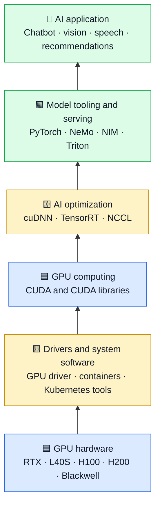
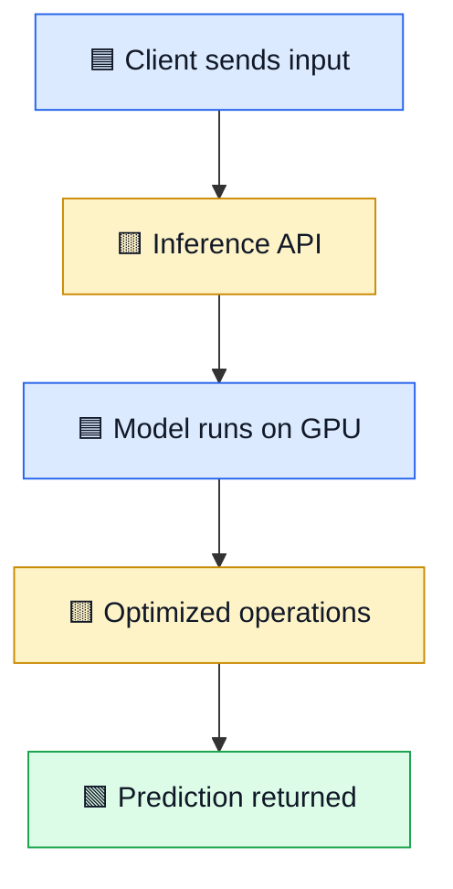

# 🟩 NVIDIA AI & GPU Stack — Simple Guide

From GPU hardware to AI applications: understand what each layer does and when it is useful.

[⬅ Articles index](README.md) · [Main repository](../README.md) · [YouTube channel](https://youtube.com/@mohammad-pse)

## 🧠 The big picture

Hardware performs calculations. The software stack helps developers use that hardware, optimize models, and serve predictions to applications.

## 🔧 Tools and their uses

| Tool | What it does | Hinglish explanation |
|---|---|---|
| **GPU** | Processor designed for large amounts of parallel work. | Bahut saari calculations ek saath karne mein useful. |
| **CUDA** | NVIDIA platform and programming model for GPU computing. | Software ko NVIDIA GPU par work karne ka platform. |
| **cuDNN** | Optimized building blocks for deep-learning operations. | Deep learning ke common operations ko fast karne wali library. |
| **TensorRT** | Optimizes supported models for inference on NVIDIA hardware. | Trained model ko prediction ke liye optimize karta hai. |
| **NCCL** | Enables efficient communication among multiple GPUs. | Multiple GPUs ke beech data exchange mein help karta hai. |
| **Triton Inference Server** | Serves models and helps manage inference workloads. | Model ko API ke through applications ke liye available karta hai. |
| **NeMo** | Toolkit for building and customizing generative AI models. | GenAI models banane aur customize karne ke tools. |
| **NVIDIA NIM** | Packaged inference microservices for supported models. | Model deploy karne ka packaged service approach. |
| **GPU Operator** | Helps manage GPU components in Kubernetes. | Kubernetes cluster mein GPU software manage karne mein help. |

## 🍳 Restaurant analogy

- **GPU = kitchen team** doing many jobs in parallel.
- **CUDA = the work instructions and tools** that let software use the GPU.
- **cuDNN = specialized equipment** for common deep-learning operations.
- **TensorRT = an optimized process** to serve predictions faster.
- **NCCL = coordination between multiple kitchens**.
- **Triton / NIM = the serving counter** that exposes model results to applications.

This is a learning analogy, not an exact technical mapping.

## 🧪 Example: an AI prediction request

A system may use a machine-learning framework to load the model, CUDA libraries to execute GPU work, TensorRT when supported and beneficial, and Triton or NIM to expose inference as a service.

## ⚖️ Training vs inference

| Term | Meaning | Example |
|---|---|---|
| Training | Model learns by updating its parameters. | Training or fine-tuning a neural network. |
| Inference | A trained model produces a result for new input. | Summarizing a document or classifying an image. |
| Latency | Time taken by a request. | How long one prompt takes to receive a response. |
| Throughput | Work completed per unit of time. | Requests handled per second. |

## 🎯 Beginner learning path

1. Understand CPU vs GPU and parallel computing.
2. Learn what CUDA is; kernel programming can come later.
3. Run a small model with a framework such as PyTorch.
4. Learn inference concepts: latency, throughput, batching, memory.
5. Explore TensorRT, Triton, or NIM when deployment needs justify them.
6. Learn multi-GPU communication when scaling requires it.

## 🎤 Interview quick questions

- **Why use a GPU?** AI workloads often perform many parallel mathematical operations.
- **Is CUDA the same as a GPU?** No. CUDA is software; the GPU is hardware.
- **Is TensorRT always required?** No. It depends on model compatibility and workload.
- **Do more GPUs always make it faster?** No. Communication, memory, and data loading can become bottlenecks.
- **What is inference serving?** Making a trained model callable by an application, often through an API.

## 🔗 Further learning

- [NVIDIA CUDA Toolkit](https://developer.nvidia.com/cuda-toolkit)
- [NVIDIA cuDNN](https://developer.nvidia.com/cudnn)
- [NVIDIA TensorRT](https://developer.nvidia.com/tensorrt)
- [NVIDIA Triton Inference Server](https://github.com/triton-inference-server/server)
- [NVIDIA NeMo](https://github.com/NVIDIA/NeMo)
- [NVIDIA NIM](https://developer.nvidia.com/nim)

[⬆ Articles index](README.md)
